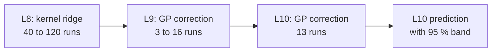

# Predicting mixing and oxygen transfer in a rocking bioreactor from cheaper simulations

Elvis Aguero · Brown University · APS DFD 2026

<!--
Cover. 12 minutes, 8 content slides. Numbers marked TO UPDATE in the notes change when the queued runs finish.
-->

---

# A 2-D rocking bag: four numbers an operator needs

- Two-phase VOF (Basilisk), embedded bag, rocking by speed $f_b$ and angle $\theta$
- Levels L6–L10 (L10: $\Delta x = 0.244$ mm)
- Wall shear $\tau_{95}$, dissipation rate (EDR)
- Oxygen transfer $k_La$ and mixing time $t_{\mathrm{mix}}$

| Level | Cost per rocking cycle |
|---|---|
| L8 | about 0.5 core-h |
| L10 | 17–64 core-h (measured) |

A cold L10 point needs about 80 cycles.

**Question:** which cheaper runs predict L10, and at what cost?

<!--
Cost per cycle at L10 is measured from the logs of 13 runs (17 core-h at 27.5-30 rpm, 64 core-h at 17.5 rpm). L8 value from the cost table. TO UPDATE: L9 cost per cycle (not measured).
-->

---

# L10 agrees with Kim et al. (2024), and was not tuned to it

- Mean shear and EDR in Kim's statistics, $\theta = 7^\circ$: L10 is within 3–7 % of Kim at 17.5, 25 and 32.5 rpm
- The narrow bump at 22.5 rpm appears at L9 and L10
- $k_La$ ($C^* = 0.10$): Kim's published values lie on our L10 prediction from 15 to 37.5 rpm

**Caution**

- Kim's mixing time is 3–5 times above ours: definitions not yet reconciled
- 2-D model; one geometry

<!--
Kim Fig 13 plots the maximum shear in water and the maximum of the spatial mean, not tau_95. Mean shear = amplitude of the signed spatial mean; EDR = maximum over time of the spatial mean (last 3 cycles). The 5x3 figure on the next slide shows the Kim points as black markers.
-->

---

# The model: a chain of Bayesian surrogates (mfbml)

- Each stage models the log of the quantity; the L9 uncertainty is carried into the L10 band
- Inputs: rocking speed and angle. Base method: Yi et al. 2407.15110
- Baselines: L9 times one constant ratio; L10 runs alone

---
layout: image
image: /chain_3x5.png
backgroundSize: contain
---

<!--
Rows: tau_95, mean shear, EDR, k_La (C*=0.10), mixing time. Columns: theta 4, 7, 9 deg. Dashed lines: L8 and L9 fits. Grey: L10 prediction and 95 % range. Black: Kim, not used in training. Faint triangles in the last row: warm-started L9 runs, not validated for mixing time (kLa: validated, 3 of 3 within 15 %; mixing time 1 of 3). All 13 L10 runs train the shear, EDR and kLa rows; each panel shows its own angle only. The mixing-time row has only 3 L10 runs: points only.
-->

---

# Held-out test: 6 new L10 runs at $\theta = 5.5^\circ$, no refit

| Quantity | Chain | L9 × one ratio |
|---|---|---|
| $\tau_{95}$ | 2.0 % | 3.2 % |
| Mean shear | 1.8 % | 1.6 % |
| EDR (time mean) | 7.0 % | 3.8 % |
| EDR (Kim's maximum) | 14.1 % | 2.9 % |

- The 95 % bands cover 6 of 6 points
- **The L9 run at the same point carries the skill.** Without it the EDR error is 18–45 %.
- A ratio on L9 matches the chain. The chain adds an honest band.

<!--
RMS relative error on the 6 test points; chain with the L9 run at the point. The pre-registered limit was 10 %: Kim's EDR maximum fails it. Cost: L9 at every point plus 3 or 4 L10 runs gives about 5 % at about 4000 core-h; L10 runs alone give 13 to 190 %. Do not claim "EDR to 4-7 %" for Kim's statistic.
-->

---

# Oxygen transfer is rough in the flow and tracks dissipation

- Runs 0.2 rpm apart jump in $k_La$ and $t_{\mathrm{mix}}$: the jumps are in the simulated flow (Kim's own code sees them)
- Not grid-converged: $k_La$ falls 37 → 15 → 8.3 1/h from L8 to L10 at 17.5 rpm
- At L10, $k_La \propto \mathrm{EDR}^{0.6}$ (13 runs, $r = 0.97$). L9 is the cheapest level that ranks L10 $k_La$ (0.82; L8: 0.19)

<!--
Blind test of the law: predictions for the five L10 runs at theta 5.5 were frozen before the runs finished. TO UPDATE when 7700075-79 end: rule law RMS <= 0.20 ln and <= 0.8 x the rpm+theta regression. Small-eddy theory gives 0.25; we do not explain 0.5-0.6. The 22.4/22.6 rpm pair at L10 differs by 0.26 in ln EDR: the roughness persists at L10 (one pair; stage 2 pending).
-->

---

# A cheaper scalar level: one flow period, repeated

- Record one converged period, repeat it 22 cycles, solve oxygen and tracer on it: 1.2 core-h against about 32 core-h at L8
- Correlation with the full L8 run: 0.98 ($k_La$ at 0.10), 0.99 (mixing time). One constant and 4 full runs: error 0.08 to 0.19 in ln (GPR on full runs alone: 0.36 to 0.71)
- Warm starts: 80 cycles cold, 12 from L8, 6 from L9

<!--
Limits: the repeated-period low fidelity starts from the converged state of the full run; mfbml is not better than one constant here. L10 flow is as periodic as L8 (cycle-to-cycle spread 0.7 %/1.0 % median at L10). TO UPDATE: the L10 record at 32.5 rpm, theta 7 (job 7806441) tests the idea at the finest level; result compares with the coupled L10 kLa 22.05/22.43 1/h. Warm L9 start reproduces kLa (3 of 3 within 15 %) but not the 50 % mixing time (1 of 3).
-->

---

# What an optimiser can trust

- **Shear and dissipation:** an L9 run at every design point plus 3 to 4 L10 runs predict L10 to a few percent (time means, $\tau_{95}$), for about 4000 core-h
- **$k_La$ and mixing time:** rough in $f_b$, not grid-converged. L9 is the minimum useful level; $k_La$ tracks dissipation
- **Cheap scalar level:** one repeated flow period predicts full-run scalars with one constant
- **Limits:** 2-D, one geometry, few L10 scalar runs, no measured $k_La$ of this bag

<!--
Closing slide. Reviewer-proof statements only: say that the chain is as good as one L9 ratio, and that the value of mfbml here is the band and the L9 requirement. Questions to expect: which kLa definition do experiments use; is there measured kLa; mechanism for the exponent 0.5-0.6; convergence criterion for scalars.
-->
